

# 🌐 IP AND DOMAIN THREAT INTEL

**`> RESOLVE IT. LOCATE IT. EXPOSE IT.`**

---

## `$ whoami`

Write-up of the TryHackMe room [IP and Domain Threat Intel](https://tryhackme.com/room/ipanddomainthreatintel) (SOC Level 1, Threat Analysis Tools).

The room teaches how an L1 analyst enriches the two indicators found in almost every alert: **domains** and **IP addresses**. The tools covered are WHOIS, DNS lookups, VirusTotal, BGP.Tools, Censys (and Shodan), TLS certificates, and VPN detection.

> Domain and IP intel changes quickly. Shodan and Censys keep data for only a few weeks, and attacker infrastructure is often taken down within days, so the room supplies exported reports. All screenshots below come from those reports.

## `$ cat targets.txt`

| Indicator | Role | What the enrichment showed |
|-----------|------|----------------------------|
| `purematrixa[.]com` | SIEM alert domain | Registered 1 day before the alert, behind Cloudflare |
| `2[.]58[.]56[.]50` | Suspected C2 server | Remcos C2 on a bulletproof-style hosting ASN |
| `64[.]89[.]160[.]44` | Malicious host | Exposed RDP and a self-signed RAT certificate |
| `raytracingengine[.]com` | APT infrastructure (challenge) | Domain on Google Cloud (US), Linux host with SSH and Telnet exposed |

## 📑 Table of contents

- [🌐 1. Domain enrichment](#-1-domain-enrichment)
- [📡 2. IP enrichment](#-2-ip-enrichment)
- [🔌 3. Service exposure](#-3-service-exposure)
- [🎭 4. VPN detection](#-4-vpn-detection)
- [🏴 5. Challenge: raytracingengine.com](#-5-challenge-raytracingenginecom)
- [🧾 Indicators of compromise](#-indicators-of-compromise)
- [🧭 MITRE ATT&CK mapping](#-mitre-attck-mapping)
- [💡 Takeaways](#-takeaways)

---

## 🌐 1. Domain enrichment

On 1 June 2026 the SIEM raised a critical alert for `purematrixa[.]com`. The first questions an analyst asks about a domain are: where does it resolve, who runs it, and how old is it.

### DNS (NsLookup)

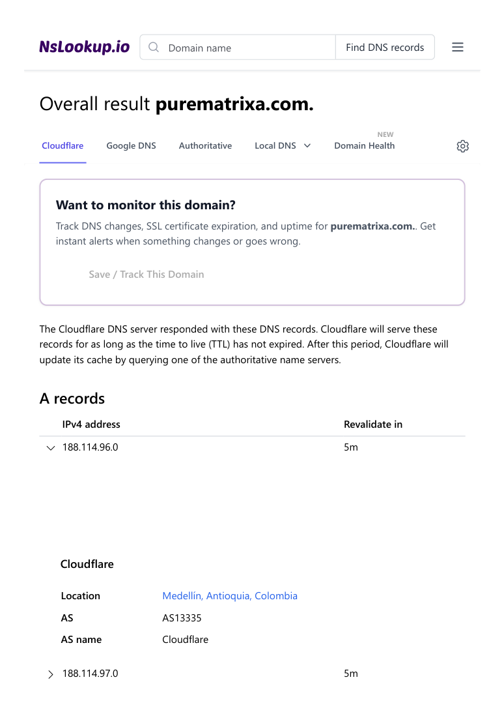

The A records are `188.114.96.0` and `188.114.97.0`, both in **AS13335 (Cloudflare)**. The domain sits behind a CDN. This is **CDN abuse**: the IP says nothing about the real origin server, because the same Cloudflare address fronts thousands of legitimate and malicious sites.

### WHOIS

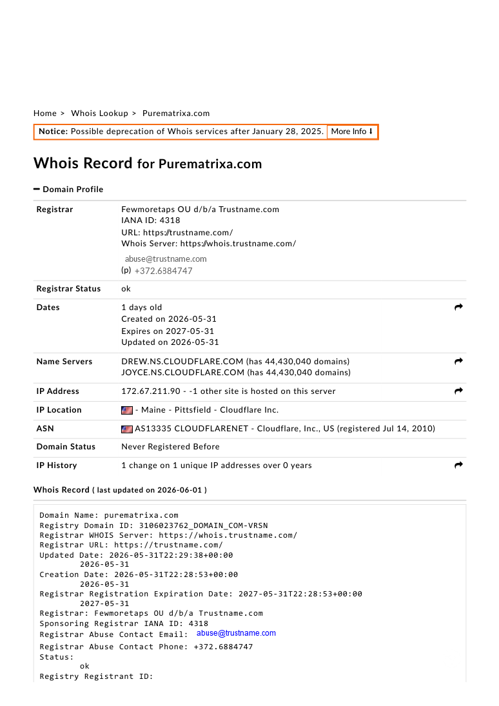

| Field | Value |
|-------|-------|
| Registrar | Fewmoretaps OU d/b/a Trustname.com |
| Created | **2026-05-31** (22:28 UTC) |
| Expires | 2027-05-31 |
| Name servers | `DREW.NS.CLOUDFLARE.COM`, `JOYCE.NS.CLOUDFLARE.COM` |
| Domain status | "Never Registered Before" |

**Domain age at the time of the alert:** it was created on 2026-05-31 and the alert fired on 2026-06-01, so the domain was only about **1 day old**. Age must be measured against the time of the event, not against today.

A one-day-old domain behind a CDN with a throwaway registration is a textbook sign of freshly prepared attack infrastructure. Legitimate domains like `tryhackme.com` are years old; malicious ones often live only days.

> Note: when the same domain was queried live months later, the registrar and update dates had changed. This is why the room supplies frozen reports.

---

## 📡 2. IP enrichment

The next alert pointed to `2[.]58[.]56[.]50`, a possible C2 server. The standard L1 enrichment is VirusTotal for reputation, then BGP.Tools for the network that owns the IP.

### VirusTotal

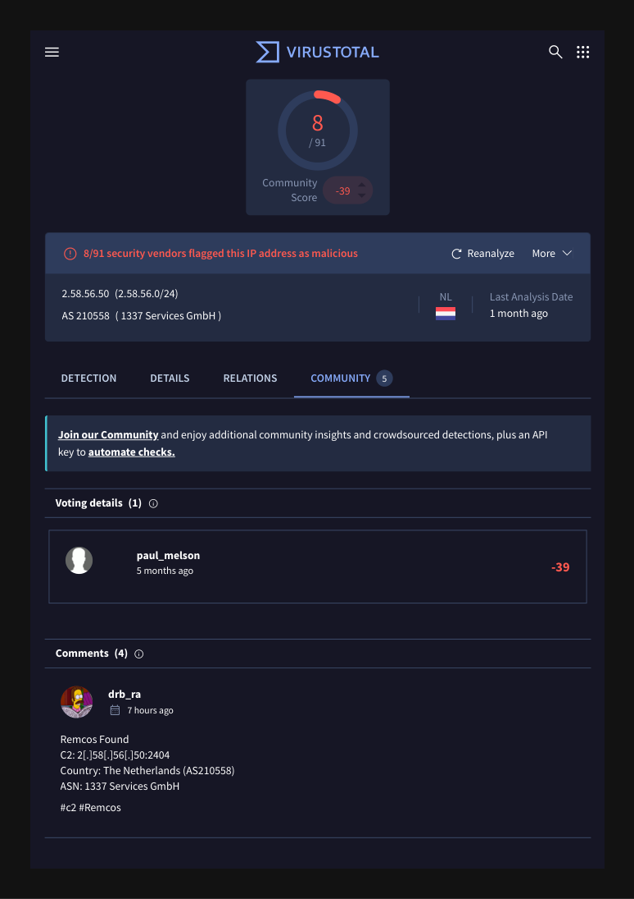

- **8 of 91** vendors flag the IP as malicious, community score `-39`.
- The IP is in **NL** (the Netherlands) and belongs to **AS210558, 1337 Services GmbH**.
- A community comment identifies the service behind it: **"Remcos Found, C2: 2[.]58[.]56[.]50:2404"** (tags `#c2 #Remcos`). Remcos is a commercial remote access tool widely abused as a RAT.

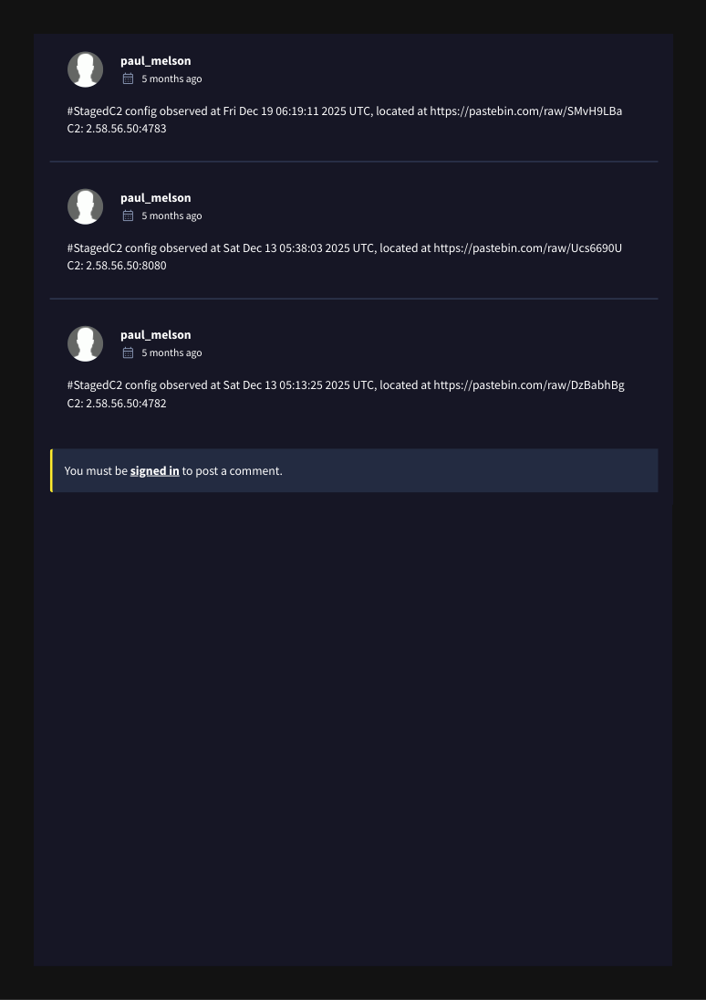

Other comments list **staged C2 configurations** pulled from Pastebin pointing at the same IP on ports `4782`, `4783` and `8080`. Malware often fetches its C2 address from a paste site, so the same server shows up on several ports.

### BGP.Tools (the Autonomous System)

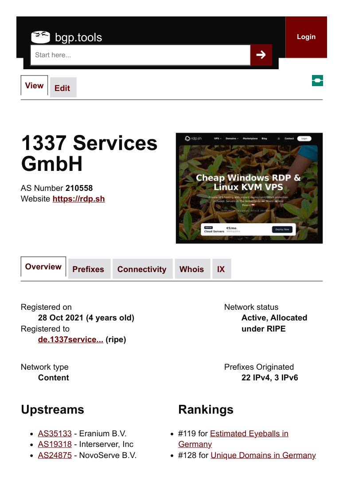

| Field | Value |
|-------|-------|
| AS | AS210558, **1337 Services GmbH** |
| Network type | Content |
| Website | rdp.sh ("Cheap Windows RDP & Linux KVM VPS") |
| Registered | 28 Oct 2021 |

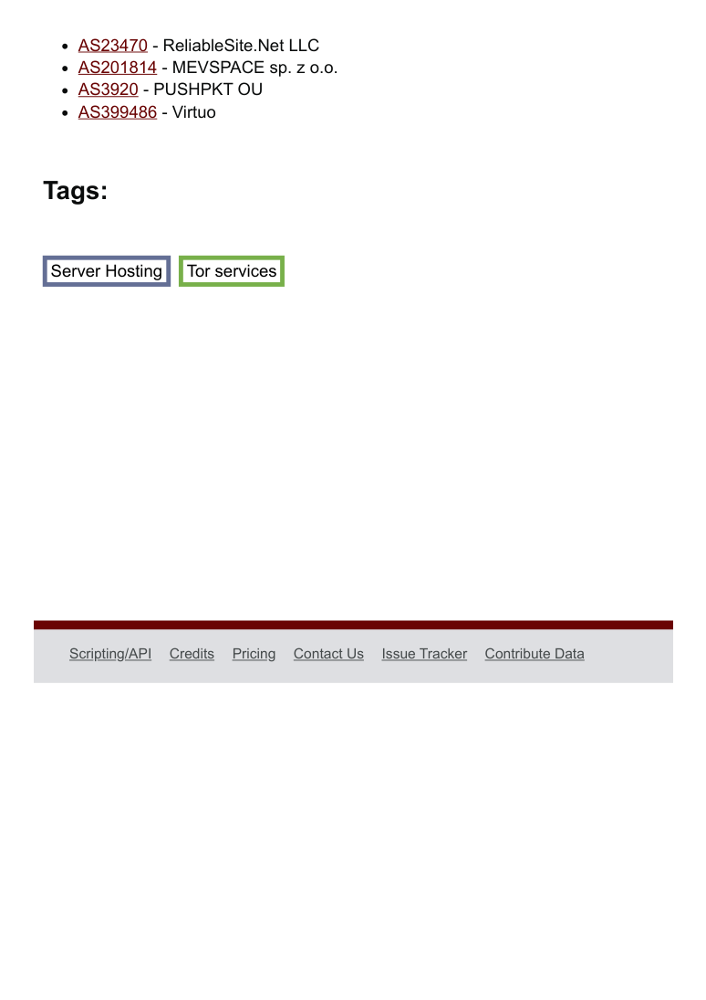

The tags are **Server Hosting** and **Tor services**. Server hosting is the riskiest AS role because adversaries rent cheap VPS machines to distribute malware and run C2, and a Tor-friendly host is a further reason for suspicion. An alert on this IP is far more worrying than one on a residential ISP address.

---

## 🔌 3. Service exposure

For the next indicator, `64[.]89[.]160[.]44`, the CTI team wanted context on its **role**. Knowing which services an IP exposes shows how an attacker got in (victim side) or whether the host is a compromised jump point (attacker side). Censys is the tool used.

### Host overview

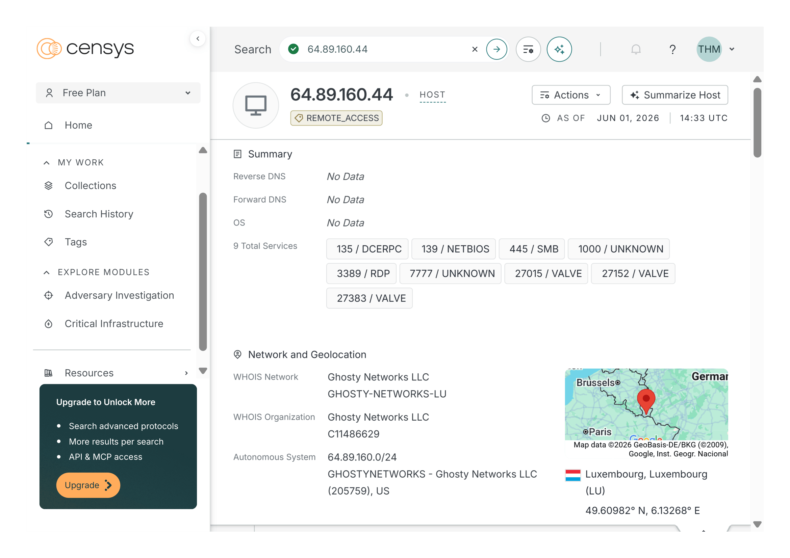

- Censys tags the host `REMOTE_ACCESS`.
- **9 total services** are exposed: `135/DCERPC`, `139/NETBIOS`, `445/SMB`, `1000/UNKNOWN`, **`3389/RDP`**, `7777/UNKNOWN`, `27015/VALVE`, `27152/VALVE`, `27383/VALVE`.
- Network: Ghosty Networks LLC, **AS205759**, located in Luxembourg.
- An exposed **RDP** service (plus SMB and NetBIOS) is a common entry point and fits a host that was either compromised or deliberately set up for remote control.

### TLS certificate on port 1000

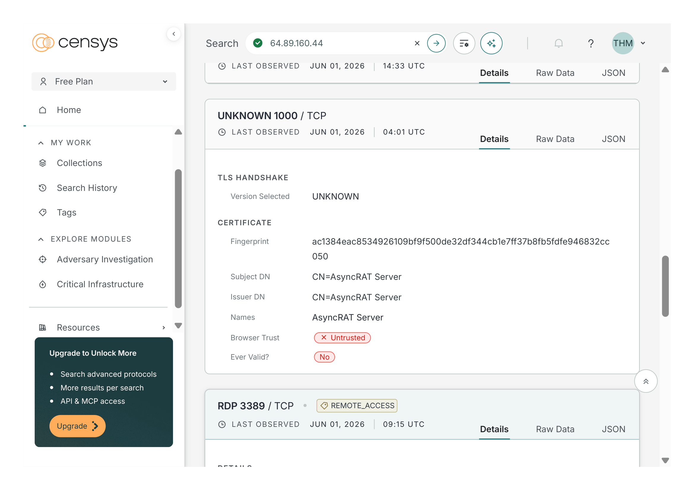

The unknown service on port 1000 gives away the C2 in its certificate:

| Field | Value |
|-------|-------|
| Subject DN | `CN=AsyncRAT Server` |
| Issuer DN | `CN=AsyncRAT Server` (same as subject: **self-signed**) |
| Browser trust | Untrusted, "Ever Valid?" No |

A self-signed certificate that names the malware itself is a direct indicator of an **AsyncRAT** C2 server. The port is non-standard, and the TLS banner leaked what is running behind it.

### Certificate details

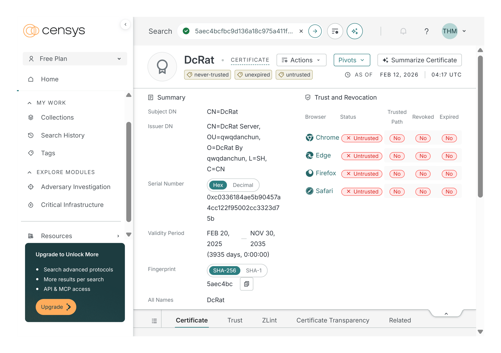

| Field | Value |
|-------|-------|
| Subject / Issuer | `CN=DcRat` / `CN=DcRat Server, OU=qwqdanchun, O=DcRat By qwqdanchun, L=SH, C=CN` |
| Validity | 2025-02-20 to 2035-11-30 |
| **Duration** | **3935 days** (about 10.8 years) |
| Trust | never-trusted, untrusted |

Default RAT-builder certificates are self-signed and valid for roughly a decade, far longer than any public CA would issue. Long validity plus a self-signed, never-trusted chain is a strong sign of malware infrastructure, and the same builder family (DcRat is an AsyncRAT fork) leaves the same fingerprints across servers.

---

## 🎭 4. VPN detection

A login from the "right" location is not proof of a real user. Services such as Mullvad, ProtonVPN and NordVPN let an attacker fake any country. IP2Proxy and Spur label VPN, proxy and Tor exit nodes.

| Scenario | Decision | Reason |
|----------|----------|--------|
| London user, London IP, but the IP belongs to **Mullvad VPN** | **Raise the alarm** | On a VPN the geolocation can no longer be trusted, and the user could be anywhere |
| London user, London IP, **no VPN match** | **Do not close as a false positive yet** | VPN lists are incomplete. Residential proxies, compromised hosts and new VPNs are missing, so keep investigating |

The analyst workflow used in the room:

1. **Domain:** does it look legitimate or like typosquatting? What is its reputation and age? Resolve it to an IP.
2. **IP:** is it a CDN range (if so, stop here)? What is its reputation (VirusTotal, AbuseIPDB)? Where is it, and is it a VPN node?
3. **AS type:** does it match the alert? Employees are not expected to log in from a cloud hosting provider.

---

## 🏴 5. Challenge: `raytracingengine.com`

An APT group has struck the company and the task is to collect everything about the malicious domain `raytracingengine[.]com` and the infrastructure behind it. Online tools return little for short-lived attacker infrastructure, so the incident report with exported data is used.

### DNS

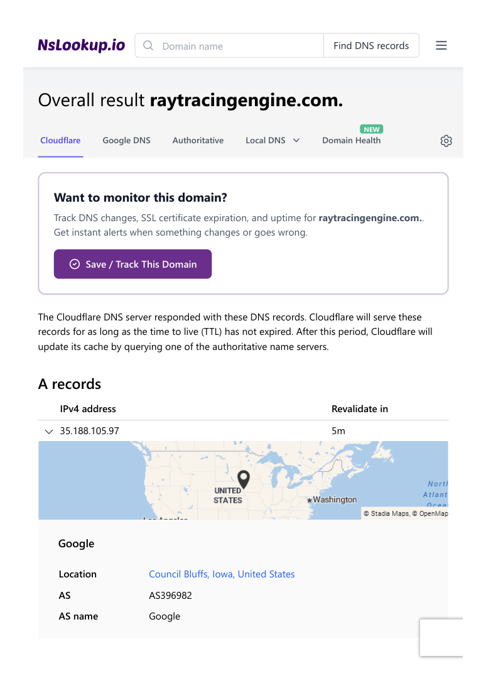

The domain resolves to **`35.188.105.97`** (AS396982, Google, Council Bluffs, Iowa, United States).

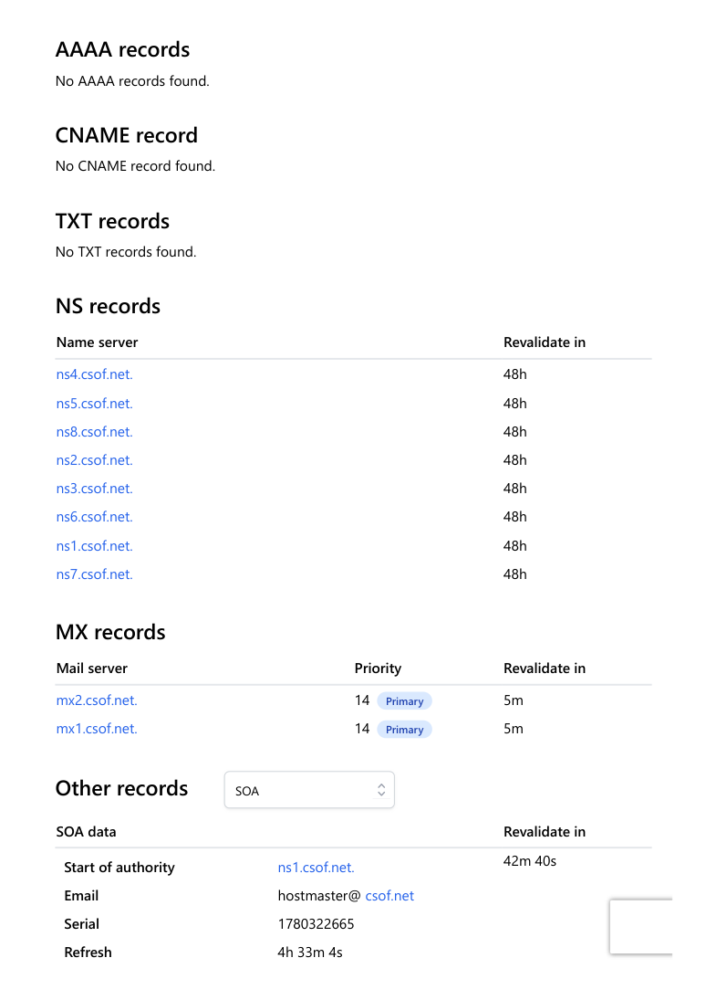

- No AAAA, CNAME or TXT records. A legitimate organisation normally has an SPF record, so empty TXT is a warning sign.
- Eight name servers (`ns1` to `ns8.csof.net`) and mail servers `mx1` and `mx2.csof.net`.

### WHOIS

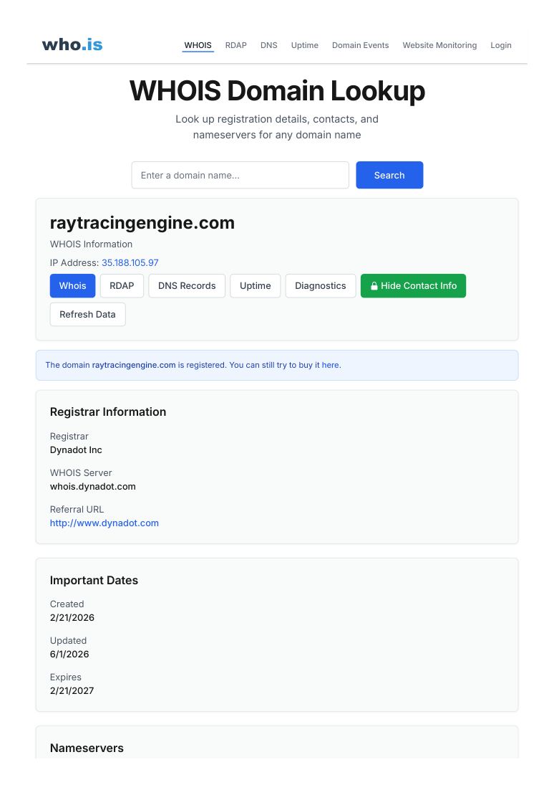

| Field | Value |
|-------|-------|
| Registrar | Dynadot Inc |
| Created | **2026-02-21** (21.02.2026) |
| Updated | 2026-06-01 |
| Expires | 2027-02-21 |
| Registrant | Redacted, "Super Privacy Service LTD c/o Dynadot" |

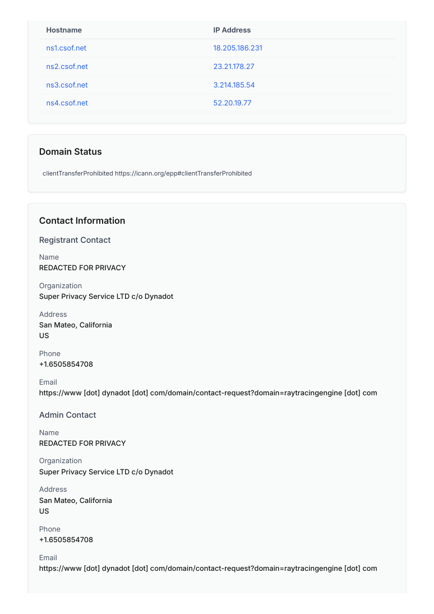

The registration is about three months old at the time of the incident and uses a privacy service, so the owner cannot be identified from WHOIS.

### Censys (exposed services)

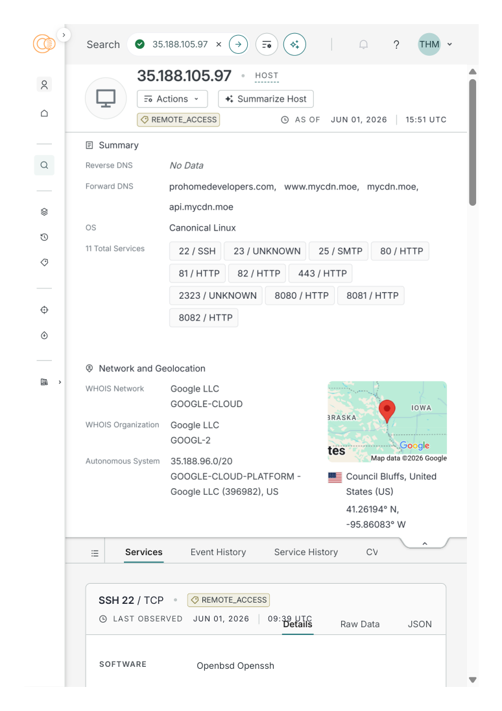

| Field | Value |
|-------|-------|
| Hosting | **Google Cloud** (Google LLC, GOOGLE-CLOUD-PLATFORM, AS396982) |
| Location | Council Bluffs, **United States** |
| **Operating system** | **Canonical Linux** (the Ubuntu vendor) |
| Total services | 11: `22/SSH`, `23`, `25/SMTP`, `80`, `81`, `82`, `443`, `2323`, `8080`, `8081`, `8082` |
| SSH banner | OpenBSD OpenSSH |
| Forward DNS | `prohomedevelopers.com`, `mycdn.moe`, `www.mycdn.moe`, `api.mycdn.moe` |
| Tag | `REMOTE_ACCESS` |

Observations:

- Telnet on ports **23 and 2323** is exposed. This is unusual on a normal server and is typical of compromised devices or a hastily built relay.
- Many HTTP services on alternate ports (`80`, `81`, `82`, `8080`, `8081`, `8082`) suggest a multi-purpose proxy or staging server rather than a single website.
- Other domains (`prohomedevelopers.com`, `mycdn.moe`) point at the same IP and are worth pivoting on to find more of the actor's infrastructure.
- The actor used a mainstream cloud provider, so blocking the IP alone may also affect legitimate Google Cloud tenants.

---

## 🧾 Indicators of compromise

| Type | Value | Context |
|------|-------|---------|
| Domain | `purematrixa[.]com` | 1 day old at alert time, behind Cloudflare |
| IP | `2[.]58[.]56[.]50` | Remcos C2, AS210558 (1337 Services GmbH), NL |
| Port | `2404`, `4782`, `4783`, `8080` | C2 ports observed on `2.58.56.50` |
| IP | `64[.]89[.]160[.]44` | AsyncRAT / DcRat host, AS205759, Luxembourg |
| Port | `1000/TCP` | TLS service leaking `CN=AsyncRAT Server` |
| Certificate | `CN=DcRat`, issuer `CN=DcRat Server`, 3935 days | Self-signed RAT certificate |
| Domain | `raytracingengine[.]com` | Created 2026-02-21, Dynadot, privacy protected |
| IP | `35[.]188[.]105[.]97` | Google Cloud, Council Bluffs US, Linux, SSH/Telnet exposed |
| Domain | `prohomedevelopers[.]com`, `mycdn[.]moe` | Forward DNS on the same IP |
| Name servers | `ns1` to `ns8.csof.net` | DNS for `raytracingengine.com` |

## 🧭 MITRE ATT&CK mapping

Mapped by hand from the infrastructure and behaviour observed.

| Tactic | Technique |
|--------|-----------|
| Resource Development | T1583.001 Acquire Infrastructure: Domains |
| Resource Development | T1583.003 Acquire Infrastructure: Virtual Private Server |
| Resource Development | T1587.003 Develop Capabilities: Digital Certificates (self-signed RAT certificates) |
| Command and Control | T1071.001 Application Layer Protocol: Web Protocols |
| Command and Control | T1571 Non-Standard Port (1000, 2404, 4782, 4783) |
| Command and Control | T1102 Web Service (C2 config staged on Pastebin) |
| Command and Control | T1090 Proxy / T1665 Hide Infrastructure (CDN and VPN fronting) |
| Lateral Movement | T1021.001 Remote Services: Remote Desktop Protocol |

## 💡 Takeaways

- **Domain age is evidence.** Measure it against the time of the alert. A domain a day old is suspicious by itself.
- **CDN means the IP tells you little.** If an A record is in a Cloudflare range, enrich the domain, not the IP.
- **Read the AS.** Server hosting and Tor-friendly networks are the riskiest roles, residential ones suggest VPN or compromised devices.
- **Community comments are intelligence.** One VirusTotal comment named the C2 framework and its ports.
- **Certificates leak the malware.** A self-signed certificate named after a RAT, valid for ten years, identifies the server.
- **A VPN hit does not close an alert, and no VPN hit does not clear one.** Lists are incomplete.
- **Data expires.** Capture screenshots and exports early, because Shodan, Censys and WHOIS change within weeks.

---

`exploitcartel` ⚡ `resolve-it-locate-it-expose-it`

